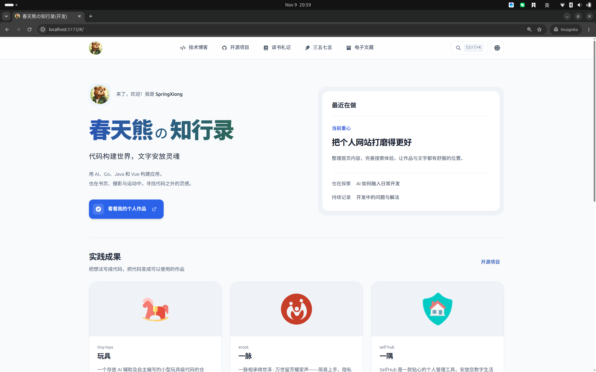
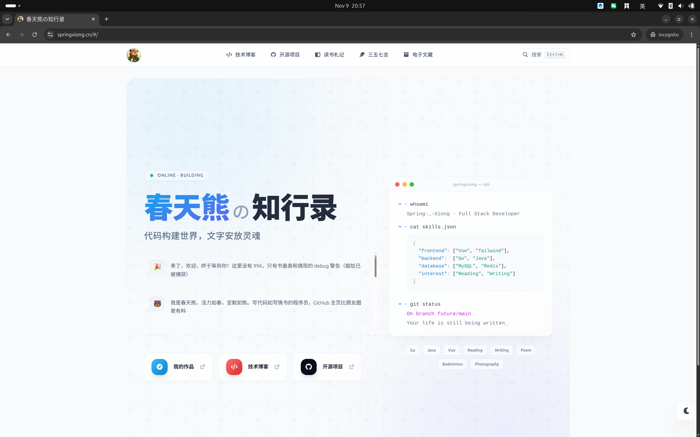

# 更新日志

本项目的所有重要变更均记录在此文件中。

本文件格式参考 [Keep a Changelog](https://keepachangelog.com/zh-CN/1.1.0/)，并遵循 [语义化版本规范](https://semver.org/lang/zh-CN/)。

## v3.0.0 - 26/11/09

- 使用 `Codex` 和 `GPT-6.1-So` 重构个人网站

## v2.0.0 - 25/12/21

- 使用 `Claude Code` 和 `DeepSeek V4 Pro` 构建个人网站

## v1.0.0 - 25/01/01

- 新增 `README.md`用于 `GitHub` 账号首页个人介绍
