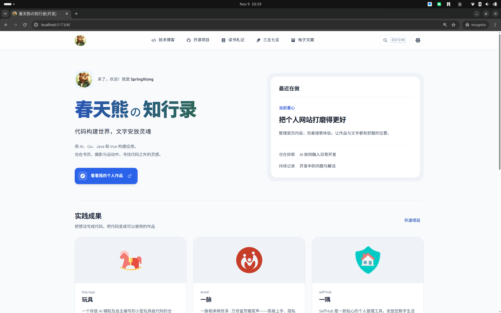
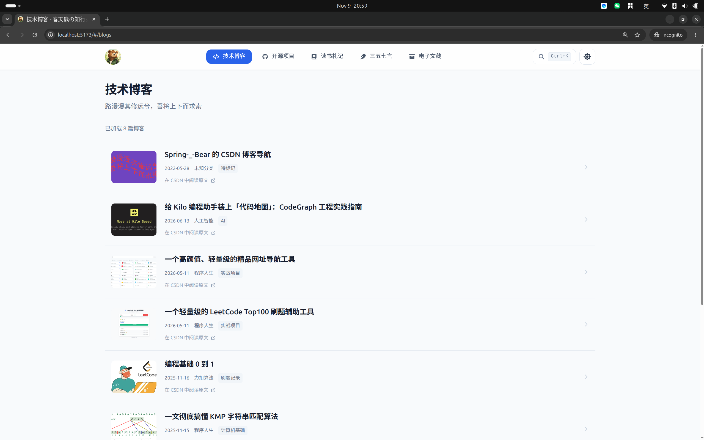
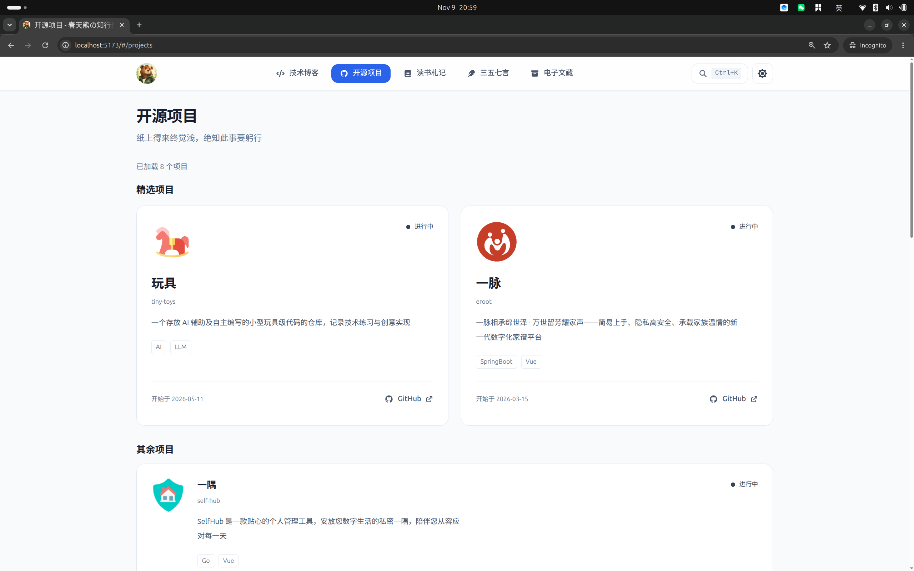
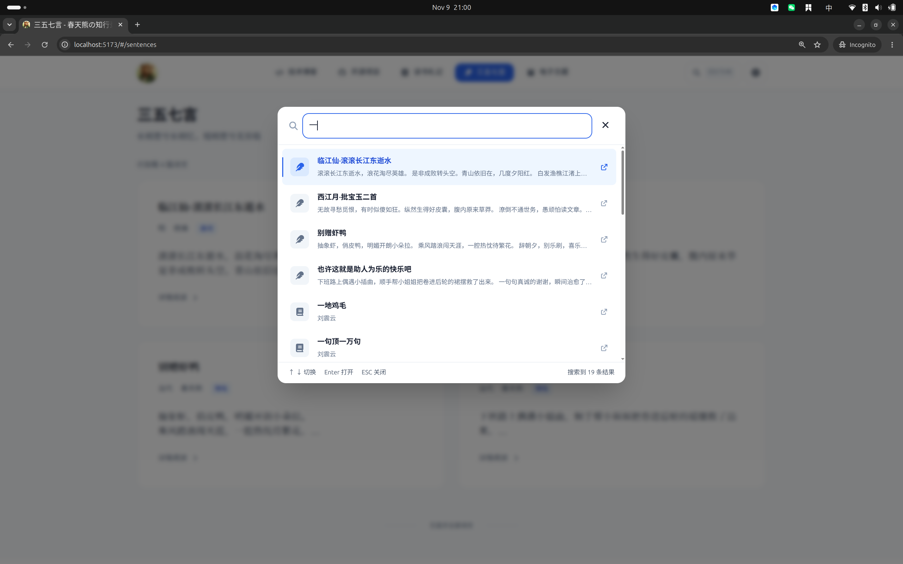

<div align="center">


# 春天熊の知行录

**代码构建世界，文字安放灵魂。**

春天熊（SpringXiong）的个人网站，记录开发实践，也收藏书页与诗词中的灵感。


[在线访问](https://springxiong.cn/) · [功能一览](#功能一览) · [快速开始](#快速开始) · [部署到 GitHub Pages](#部署到-github-pages) · [开发指南](#开发指南)

</div>

---

## 关于知行录

这里既是个人作品与技术记录的入口，也是阅读与文字的收藏空间。首页汇集近期关注和内容摘要，各栏目提供更完整的浏览体验。

- **集中展示**：将项目、博客、读书记录与诗词整理在一个站点中。
- **顺畅阅读**：支持全局搜索、分页加载，切换栏目后恢复浏览位置。
- **明暗皆宜**：支持浅色、深色及跟随系统主题，保存个人偏好。
- **多端访问**：适配桌面与移动设备，支持键盘操作和减少动态效果。

## 功能一览

| 栏目或功能 | 可以做什么 |
| :--- | :--- |
| 首页 | 查看个人介绍、近期关注，以及项目、博客、书籍和诗词摘要 |
| 技术博客 | 浏览开发记录，查看分类与标签，进入原文阅读 |
| 开源项目 | 查看精选项目、技术栈与项目状态，访问项目链接 |
| 读书札记 | 浏览书籍与阅读记录 |
| 三五七言 | 浏览诗词摘录，打开详情弹窗阅读与复制原文 |
| 电子文藏 | 浏览收录的文档资源及其访问链接 |
| 全局搜索 | 使用 `Ctrl + K` 打开搜索，通过方向键选择结果并按回车打开 |

内容加载提供骨架屏、空状态和失败重试；弹窗支持焦点管理，页面提供跳转至主要内容的键盘入口。

## 界面预览



<details>
<summary>查看更多页面</summary>





</details>

## 快速开始

### 环境要求

- Node.js：`^22.22.2 || ^24.15.0 || >=26.0.0`，与 `package.json` 保持一致。
- npm：用于安装依赖和执行项目脚本。
- 可访问的后端 API：本仓库仅包含前端，不包含后端服务或本地模拟数据服务。

### 安装与启动

在仓库根目录执行：

```bash
npm ci
npm run dev
```

打开终端输出的本地地址。启动前请按下文确认环境配置；若后端不可用，相关内容会显示加载失败提示。

### 构建与预览

```bash
npm run build
npm run preview
```

生产文件输出到 `dist/`。预览服务用于本地验证，不作为生产服务器使用。

## 数据来源与环境配置

博客、项目、书籍、诗词、文藏和搜索结果来自远程 API；分类及标签通过字典接口加载。浏览器本地存储用于保存主题偏好，内容加载仍需要网络连接。

后端请求由 [`src/utils/request.js`](./src/utils/request.js) 统一处理，内容接口位于 [`src/api/mine.js`](./src/api/mine.js)，字典接口位于 [`src/api/dict.js`](./src/api/dict.js)。

### 环境变量


项目使用 Vite 环境文件：

| 文件 | 用途 |
| --- | --- |
| `.env` | 各环境共享配置 |
| `.env.development` | 本地开发模式配置 |
| `.env.production` | 生产构建模式配置 |
| `.env.local` | 本地通用覆盖配置 |
| `.env.development.local` / `.env.production.local` | 对应模式的本地覆盖配置 |

主要配置项：

| 变量 | 说明 |
| --- | --- |
| `VITE_APP_TITLE` | 网站及路由页面标题 |
| `VITE_APP_LOGO_URL` | 头像与页面分享图片地址 |
| `VITE_APP_PORTFOLIO` | 首页个人作品入口地址 |
| `VITE_APP_BASE_API` | Axios 请求基础地址 |
| `VITE_APP_OPEN_TOKEN` | 请求头 `X-Open-Token` 的值 |

### 后端接入

开发服务在 `vite.config.js` 中将 `/self-hub` 代理至 `https://api.springxiong.cn/self-hub/open/`。使用该代理时，将 `VITE_APP_BASE_API` 配置为 `/self-hub`；接入其他后端时同步调整代理目标。

生产构建不包含 Vite 开发代理，需要配置可访问的 API 地址或由部署环境提供反向代理。接口约定业务成功码为 `code: 0`，实际数据位于 `data` 字段。

`VITE_*` 变量会进入浏览器构建产物，请勿放入私密凭据。修改环境文件后需重启开发服务或重新构建。

## 部署到 GitHub Pages

项目为静态前端应用，使用 Hash 路由，构建产物位于 `dist/`，可部署到 GitHub Pages 等静态托管服务。

1. 在仓库的 **Settings → Pages → Build and deployment → Source** 中选择 **GitHub Actions**。
2. 将代码推送到 `main` 分支，触发自动检查、构建与部署。
3. 在 **Actions → Deploy to GitHub Pages** 中查看执行结果，成功后通过部署环境中的地址访问站点。

工作流位于 [`.github/workflows/deploy-pages.yml`](./.github/workflows/deploy-pages.yml)，使用 Node.js `22.22.2`，执行 `npm ci` 和 `npm run check`，通过后发布 `dist/`。也可在 Actions 页面选择 **Run workflow**，使用 `main` 分支手动部署。无需将 `dist/` 提交到源码分支。

部署前请确认生产环境 API 可访问，并允许站点的跨域请求，或配置同源反向代理。迁移域名或复用本站时，同步检查 `index.html` 中的站点地址与分享信息、`public/sitemap.xml`、`public/robots.txt`，以及页脚品牌信息。

## 开发指南

### 技术栈

| 类别 | 技术 |
| --- | --- |
| 前端框架 | Vue 3、Composition API、单文件组件 |
| 构建工具 | Vite |
| 路由与状态 | Vue Router、Pinia |
| 样式与图标 | Tailwind CSS、Font Awesome 图标子集 |
| 网络请求 | Axios |
| 测试 | Vitest、Vue Test Utils、jsdom |
| 代码质量 | ESLint、Prettier |
| 持续集成与部署 | GitHub Actions、GitHub Pages |

业务代码使用 JavaScript 与 ES Modules，路由采用 Hash 模式。

### 目录结构

```text
.
├── .github/workflows/       # 持续集成与 Pages 部署
├── public/                 # 网站图标、robots.txt、站点地图
├── resources/img/          # 页面展示截图
├── scripts/                # 图标生成脚本
├── src/
│   ├── api/                # 内容与字典接口
│   ├── components/         # 布局、列表、卡片、弹窗和骨架屏
│   ├── composables/        # 分页、搜索、主题及焦点管理
│   ├── router/             # 路由、页面标题与滚动恢复
│   ├── stores/             # Pinia 字典状态
│   ├── utils/              # 请求、日期与字符串工具
│   ├── views/              # 首页及各内容栏目
│   ├── App.vue             # 应用布局与全局交互
│   ├── main.js             # 应用入口
│   └── style.css           # 全局样式
├── tests/                  # 单元与组件测试
├── index.html              # HTML 入口与 SEO 元信息
└── vite.config.js          # 构建配置及开发代理
```

### 常用命令

| 命令 | 说明 |
| --- | --- |
| `npm run dev` | 启动开发服务 |
| `npm run build` | 构建生产资源至 `dist/` |
| `npm run preview` | 本地预览构建产物 |
| `npm test` | 运行全部测试 |
| `npm run test:watch` | 监听文件变化并运行测试 |
| `npm run lint` | ESLint 检查，不允许警告 |
| `npm run format:check` | 检查代码格式 |
| `npm run format` | 格式化代码 |
| `npm run icons:generate` | 扫描源码并生成 `src/icons.css` |
| `npm run icons:check` | 检查图标产物是否与源码一致 |
| `npm run check` | 依次执行图标、格式、Lint、测试与生产构建检查 |

运行单个测试文件：

```bash
npm test -- tests/pagination.test.js
```

### 测试与验证

测试使用 Vitest、Vue Test Utils 和 jsdom，位于 `tests/*.test.js`，覆盖分页、搜索、字典恢复、路由错误及弹窗交互等行为。修改功能后运行对应测试，提交前执行 `npm run check`；界面变更还应在浏览器中检查移动端、桌面端及明暗主题。

### 参与贡献

开发规范见 [AGENTS.md](./AGENTS.md)。提交前运行 `npm run check`；行为变更应补充必要测试。合并请求请说明修改目的、具体行为及验证结果，界面调整附上截图。

## 许可证

本项目采用 [MIT License](./LICENSE)。Font Awesome 图标的许可说明见生成文件 `src/icons.css` 的头部注释。
